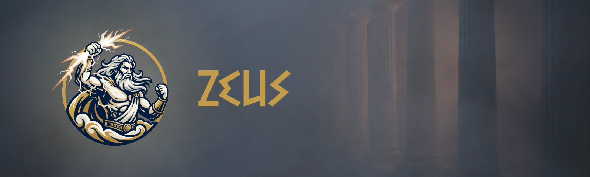
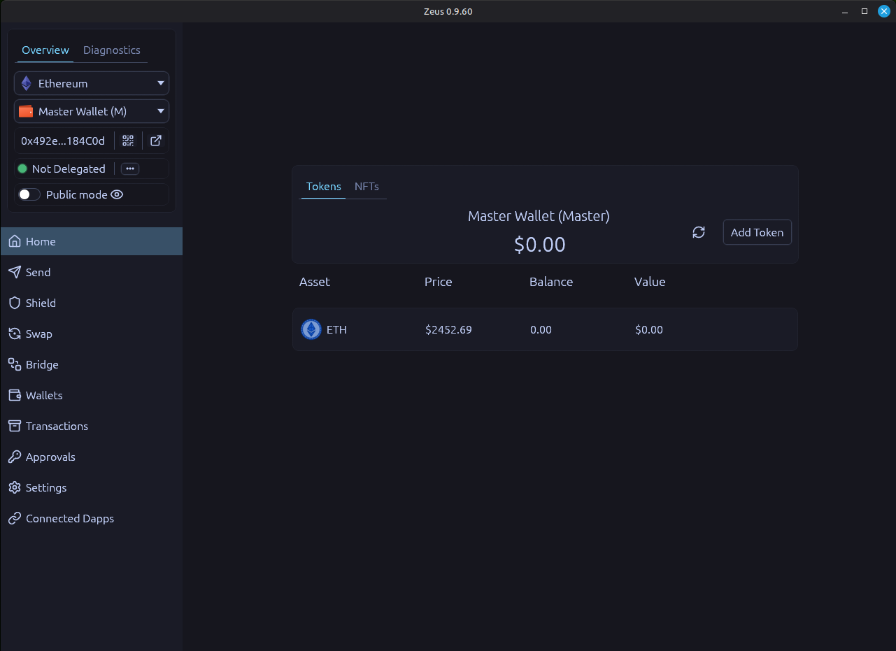

<p align="center">
  
</p>

# <p align="center">Zeus</p>

## <p align="center"><b>A seedless, self-custodial Ethereum wallet that just works.</b></p>

<p align="center">

</p>
 
 ---

 ### Zeus is also available on [radicle](https://radicle.network/nodes/rosa.radicle.network/rad%3AzNS8uWXgE8r87Zb8ito1wzg84gbc)
 ### RID: `rad:zNS8uWXgE8r87Zb8ito1wzg84gbc`
 
 
## Installation

1. Download the latest release from the [Releases](https://github.com/greekfetacheese/zeus/releases)
2. Zeus is portable, you just need to extract the folder and run the `zeus-gui` executable.

**Zeus saves and loads its data from the current directory it exists, so if you want to move it move it with the entire folder**


## Supported Chains
- Ethereum Mainnet
- Optimism
- Arbitrum
- Base
- Binance Smart Chain
- Robinhood

## Supported Platforms
- Windows
- Linux

## Minimum System Requirements
- RAM: 8GB (For wallet recovery)

---

## How Wallet management work in Zeus
Zeus is **seedless**, meaning that you don't need to have a seed phrase or a private key to access your wallet.

The first time you run Zeus you will be prompted to enter a **username** and a **password**. This will be used to derive your
master wallet **(BIP-32 Hierarchical Deterministic Wallet)** and you can generate as many wallets under it as you want.

You can also import an existing wallet by entering the mnemonic phrase or a private key, but these cannot be recovered
if you lose your vault.

It is very important that you don't forget your **username** and **password**, otherwise wallet recovery will be
impossible.

---

## How the wallet recovery works
Given that **username** and **password** a hash is generated using [Argon2Id](https://github.com/P-H-C/phc-winner-argon2) 
with the following parameters:
- **Salt:** SHA512 of the username
- **Memory cost:** 8192_000 KiB
- **Iterations:** 96
- **Parallelism:** 1
- **Byte length:** 64 bytes

These parameters are constants and will not change in the near future.

Then a private key is derived based on the [BIP32](https://github.com/bitcoin/bips/blob/master/bip-0032.mediawiki) standard using the hash as the seed.
This private key then is used as your master wallet.

---

## How safe this recovery method is?
If we assume that the username and password have a decent entropy (at least 128bits 16+ characters) and the password is
not ever **exposed** in past breaches, it is practically impossible for someone to brute force your wallet. 

---

## Connecting to dapps
It is possible to connect Zeus to dapps through the [wallet-connector](https://github.com/greekfetacheese/zeus/tree/main/wallet-connector) extension, for chromium based browsers (Chrome, Brave etc.).

Currently the extension is not listed in the Chrome Web Store, so you will need to install it manually.

## Installing the extension
1. Download the **wallet-connector.zip** from the latest [release](https://github.com/greekfetacheese/zeus/releases)
2. You can use this [guide](https://bashvlas.com/blog/install-chrome-extension-in-developer-mode) on how to install the extension in developer mode.
3. Once the extension is enabled no further action is needed.


## Features

| Feature | Details |
|--------|---------|
| **Wallet management** | Create unlimited wallets under one master, import/export wallets |
| **Send** | ETH, ERC-20 and NFT (ERC-721 / ERC-1155) transfers |
| **NFTs** | Track, view, send and receive ERC-721 / ERC-1155 collectibles; art is fetched on demand and cached on disk (opt-in, off by default) |
| **Swaps** | Uniswap via the [Universal Router](https://docs.uniswap.org/contracts/v4/deployments) |
| **Cross-chain bridge** | Bridge ETH across supported chains with [Across](https://across.to/) (**BNB not supported**) |
| **Portfolio** | public + private balance (Railgun) |
| **Tx simulation** | Local EVM sims with [revm](https://github.com/bluealloy/revm) + Balance & Approval diffs |
| **MEV protect** | MEV-vulnerable txs prefer mev-protect RPCs |
| **Dapp connect** | Via the [wallet-connector](https://github.com/greekfetacheese/zeus/tree/main/wallet-connector) extension |

### Railgun

Railgun is natively (no 3rd party) integrated in Zeus. Private balances shown in the UI cover **ERC-20 and ERC-721**.
<br/>
**ERC-1155 is not supported yet by Railgun**.

| Operation | Assets | Notes |
|-----------|--------|--------|
| **Shield** | ERC-20, ERC-721 | Move public funds into the private pool |
| **Unshield** | ERC-20, ERC-721 | Default: private broadcaster (paymaster). Optional **self-broadcast** for emergency withdrawals (breaks anonymity). Optional unwrap WETH → ETH to fund new empty wallets |
| **Private transfer** | ERC-20, ERC-721 | Send privately to a `0zk` address |
| **Merge notes** | ERC-20 only | Consolidate UTXO notes for an asset |

### RPC / data model

Zeus is built around the Ethereum RPC API. It does not depend on a third-party indexer or hosted backend, give it an RPC endpoint and it is ready to go.

Because of that it does **not** auto-index chain data (historical approvals, every token balance, etc.). It tracks what it has fetched and what you do in-app.

By default it uses free public RPCs from [Chainlist.org](https://chainlist.org/).
When you start Zeus for the first time **no RPC calls are made**, you can either enable any of the default RPCs or bring your own.

I have done my best to make Zeus as efficient as possible when making RPC calls so it can even work with crappy public endpoints, however not all will work properly, its still best to use a paid provider or self-host your own node.

---

## Accessibility

Zeus builds an accessibility tree through [AccessKit](https://accesskit.dev/), so a screen reader can read the window and operate it without a mouse. The tree describes what is on screen and nothing else: a control is named for what it does, its state is part of the node, and anything a sighted user only learns by hovering is also written into the node's description.

What a screen reader hears:

- every page, dialog and control by name, with the page heading taking focus when a page opens;
- amounts and balances as numbers with their unit, and every address in full and grouped in fours — never the shortened form;
- a disabled button under its own name, with the reason it is blocked as a sentence above it;
- waits that say what they are doing ("Sending your transaction…", "Generating the private proof. This takes a few seconds and cannot be cancelled.") and results that are said once rather than on every frame.

Keyboard: Tab and Shift+Tab move through the page and into an open picker, Enter or Space activates the focused control (or picks the focused option), and Escape closes whatever is on top — a dialog, a picker, or the Settings window. Every prompt has a way out that is not its primary action, and its copy says which one that is.

### What is not accessible, and what to do instead

| Surface | Why it cannot be spoken | What Zeus does instead |
|---|---|---|
| Private keys and recovery words | Speech is persisted — screen-reader logs, speech viewers, a headset | The export dialog copies the key to the clipboard from a named button. The key is never spoken and never enters the tree |
| Passwords | Reading one back is the same leak as echoing it | The field says its name and how many characters it holds |
| QR codes | A QR is a picture | Every QR surface draws the address as text beside it, with a button that copies the whole address |
| A private (`0zk`) address | It cannot be checked by ear | It is read as its length and last characters; use Copy, or the QR, to move it between devices |
| OS file dialogs, the clipboard, the tray icon | They belong to the desktop, not to Zeus | Their accessibility is the platform's |

Developed against Orca on Linux, which needs the AT-SPI bridge (GNOME and KDE start it; a bare window manager needs `at-spi2-core`). The same tree reaches Narrator and NVDA on Windows through AccessKit's platform adapter; those passes are less exercised, so reports are welcome.

### Reporting an accessibility problem

The tree a reader is handed can be dumped from the test suite:

```
ZEUS_ACCESSIBILITY_DUMP=1 cargo test --features dev --bin zeus accessibility
```

This writes `logs/accessibility-tree.txt`, one line per node with its role, name, value, description and actions. It is taken from a headless test frame rather than the running app, so it shows what the interface *would* say on that screen. Please attach it to the issue, with the screen you were on and what you expected to hear.

---

## Security
- **Strong encryption:** Zeus uses the [Argon2Id](https://github.com/P-H-C/phc-winner-argon2) as a KDF and [xChaCha20Poly1305](https://en.wikipedia.org/wiki/ChaCha20-Poly1305) as the encryption algorithm to derive the master wallet and encrypt the `Vault`.
- **No private key leaks:** Zeus uses [secure-types](https://github.com/greekfetacheese/secure-types) to handle private keys and other sensintive data in-memory. This makes it extremely hard for an attacker/malware to extract any private keys.
- **No telemetry:** Zeus does not need neither communicates with any third-party server, everything you do stays local on your computer.

## Bugs/Issues
I'm not aware of any major bugs, feel free to open an issue if you find any.

---


## Credits
Zeus wouldn't be possible without:
- [alloy-rs](https://github.com/alloy-rs/alloy)
- [revm](https://github.com/bluealloy/revm)
- [egui](https://github.com/emilk/egui)


## Build from source

For development:
```
cargo build --features dev
```

For release:
```
cargo build --profile prod
```